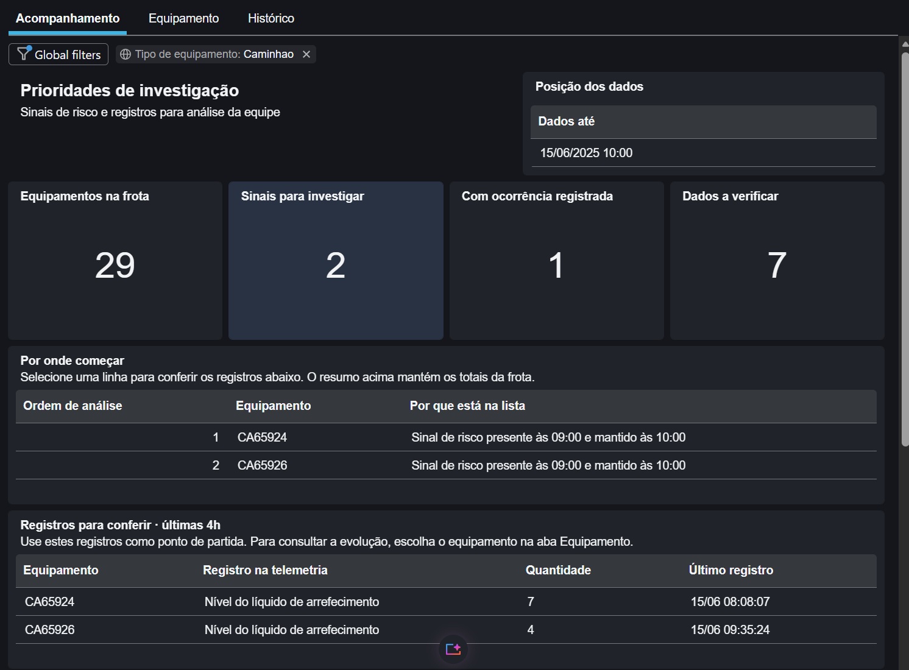

# Monitoramento da frota

Dashboard e assistente de dados para equipes de manutenção priorizarem quais
caminhões investigar, conferirem os registros e consultarem ocorrências anteriores.

**1º lugar em Análise Avançada de Dados · Programa Desenvolver 2026 da Vale**

Desenvolvi o trabalho premiado *Antecipação de Alertas Críticos em Frotas de
Mineração*. Depois da submissão, implementei a evolução no Databricks, da
preparação da telemetria à lista de investigação, com dashboard AI/BI e Genie.

## Uma investigação na prática

Às **10h de 15/06/2025**, no recorte histórico de 29 caminhões, a lista de
**Acompanhamento** destacou dois para investigação. Ambos continuavam na lista
sem novo aviso naquele horário. Na janela das quatro horas anteriores, havia
sete registros de nível do líquido de arrefecimento no primeiro caminhão e
quatro no segundo.



A ordem vem da política de priorização. Os registros apontam o que conferir
em **Equipamento**. Em **Histórico**, é possível ver se sinais semelhantes
apareceram em outros dias. O Genie consulta as mesmas fontes e aceita uma
pergunta como “Por qual caminhão devo começar e quais registros devo conferir?”

[Veja a investigação por equipamento, o histórico e a resposta do Genie](docs/demonstracao.md).

## Execute a política de priorização

Com `uv` e Python 3.12, na raiz do repositório:

```bash
uv sync --frozen
uv run python -m examples.run_policy
uv run pytest -q
```

O [exemplo](examples/run_policy.py) usa pontuações sintéticas de três caminhões
em dois horários. A [política](fleet_monitoring/policy.py) ordena os scores,
aplica um limite de candidatos por horário e respeita um intervalo mínimo entre
avisos para o mesmo equipamento. No segundo horário, um caminhão segue na lista
mesmo sem receber novo aviso. Esse exemplo roda localmente com scores já fornecidos.

## Avaliação histórica

Em junho de 2025, a política congelada associou **75 de 222 episódios elegíveis
à avaliação (33,8%)** a avisos anteriores. Foram emitidos 251 avisos, dos quais
75 foram associados a episódios. Entre as correspondências, a antecedência
mediana foi de 93,9 minutos. O recorte avalia priorização retrospectiva.

A preparação usa somente a informação disponível no instante da avaliação.
Veja [como a solução foi construída e avaliada](docs/arquitetura-e-avaliacao.md)
para entender as fontes, as unidades de análise e os limites dos resultados.

[Licença do código](LICENSE) · [Autoria e origem dos materiais](NOTICE.md)
