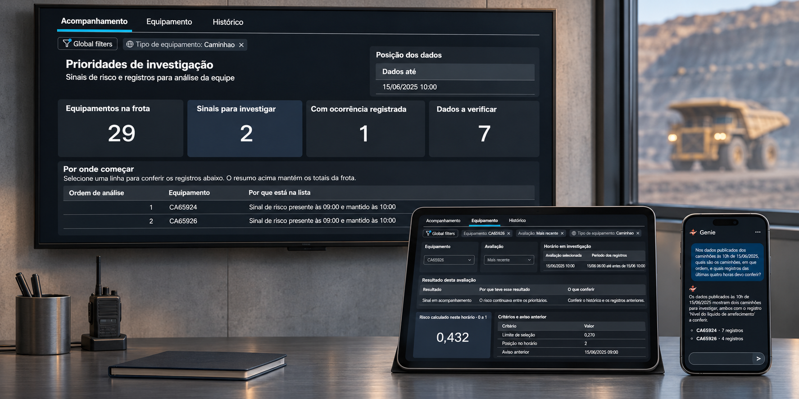
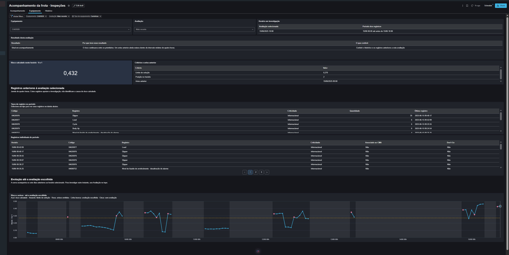
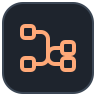
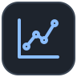

# Monitoramento da frota

Dashboard com Genie integrado para equipes de manutenção priorizarem quais
caminhões investigar, conferirem os registros e consultarem ocorrências anteriores.



*Conceito de uso em uma central de manutenção. A TV, o iPad e o celular exibem abas do mesmo dashboard, com o Genie aberto ao lado do painel na TV.*

**1º lugar em Análise Avançada de Dados · Programa Desenvolver 2026 da Vale**

O **Monitoramento da Frota** recebeu o primeiro lugar com uma solução em
Databricks que usa telemetria para priorizar caminhões para investigação.
O painel AI/BI integrado ao Genie permite conferir os registros que
sustentam cada sinal.

[Relatório submetido à Vale (cópia pública em PDF)](docs/relatorio-da-competicao.pdf)

## Uma investigação na prática

Às **10h de 15/06/2025**, no recorte histórico de 29 caminhões, a lista de
**Acompanhamento** destacou dois para investigação. Ambos continuavam na lista
sem novo aviso naquele horário. Nas quatro horas anteriores, havia sete
registros de nível do líquido de arrefecimento no primeiro caminhão e quatro
no segundo.

A equipe pode começar pela fila, abrir a avaliação do caminhão em
**Equipamento** e consultar avisos e ocorrências no **Histórico**. No
próprio dashboard, basta abrir o **Genie** para perguntar “Por qual caminhão
devo começar e quais registros devo conferir?”

<details>
<summary>Ver as telas reais da demonstração</summary>

### Acompanhamento

O resumo do recorte mostra 29 caminhões, dois sinais para investigar, um
equipamento com ocorrência registrada e sete com dados a verificar. O Genie
aparece na lateral do painel.


### Equipamento

No caminhão CA65926, o sinal continuava prioritário às 10h. O aviso das 09h
ainda estava dentro do intervalo mínimo de quatro horas entre avisos. A tela
mostra os registros das 06h até antes das 10h.



### Histórico

As barras contam caminhões distintos por dia com avisos do sistema e com
registros de Don’t Go. Um caminhão pode aparecer nos dois grupos.


### Genie

O assistente retornou a mesma ordem, sete e quatro registros de nível do
líquido de arrefecimento e nenhum novo aviso às 10h.


</details>

## Construído no Databricks

|  |  |  |  |  |  |
|:---:|:---:|:---:|:---:|:---:|:---:|
| **Databricks**<br>Compute e Unity Catalog | **Medallion**<br>Bronze · Silver · Gold | **dbt**<br>Transformações | **MLflow**<br>Experimentos e registro | **AI/BI Dashboards**<br>Painel de investigação | **Genie**<br>Consultas em linguagem natural |

O PySpark carrega a telemetria e os apontamentos na Bronze. O dbt organiza
os eventos e os episódios na Silver e gera 46 features por equipamento e
hora na Gold. O modelo LightGBM é registrado no MLflow. As prioridades e os
registros chegam ao dashboard e ao Genie pelas mesmas views.
[Detalhes da arquitetura](docs/arquitetura-e-avaliacao.md#da-telemetria-à-investigação)

## Avaliação em junho de 2025

O teste retrospectivo cobre **17.203 observações de 31 equipamentos**. A
reprodução refez o treino em um ambiente Databricks separado, selecionou
LightGBM e fixou o limite em três candidatos por horário, ante cinco na
referência histórica.

| Medida | Referência histórica | Reprodução |
|---|---:|---:|
| Episódios elegíveis associados a aviso | 75 de 222 (33,8%) | 78 de 222 (35,1%) |
| Avisos associados a episódio | 75 de 251 (29,9%) | 78 de 246 (31,7%) |
| Antecedência mediana dos avisos associados | 93,9 min | 93,3 min |

Na referência histórica, 75 de 220 episódios de caminhões foram associados
a avisos (34,1%). As escavadeiras tiveram dois episódios elegíveis. As
capturas mostram o recorte histórico, e a avaliação mede a priorização
retrospectiva. [Arquitetura, metodologia e limites](docs/arquitetura-e-avaliacao.md)

## Reproduza o projeto

O repositório inclui os [nove arquivos de entrada](data/README.md), a ingestão
PySpark, as transformações dbt, o treino com LightGBM e MLflow e o scoring com
a política de avisos. Dashboard e Genie consultam as mesmas views de
investigação. [Guia de reprodução](docs/reproducao.md)

Em um computador novo, abra o clone em um assistente com acesso ao terminal.
Peça que siga o guia de ponta a ponta usando o perfil Databricks que você
escolher. A primeira autenticação da CLI pode pedir sua confirmação no navegador.

### Execute a política localmente

Com `uv` e Python 3.12, rode na raiz do repositório.

```bash
uv sync --frozen
uv run python -m examples.run_policy
```

O [exemplo](examples/run_policy.py) usa pontuações sintéticas de três caminhões
em dois horários. A [política](fleet_monitoring/policy.py) ordena os scores,
aplica um limite de candidatos por horário e respeita um intervalo mínimo entre
avisos para o mesmo equipamento. No segundo horário, um caminhão segue na lista
mesmo sem receber novo aviso.

[Como contribuir](CONTRIBUTING.md) · [Licença do código](LICENSE) · [Autoria e origem dos materiais](NOTICE.md)
