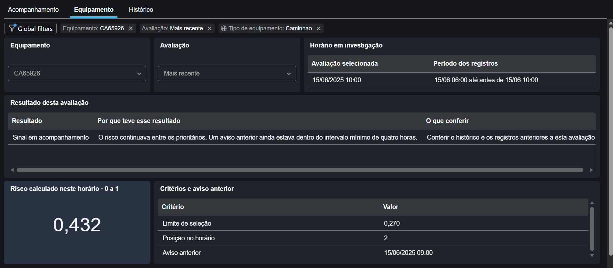
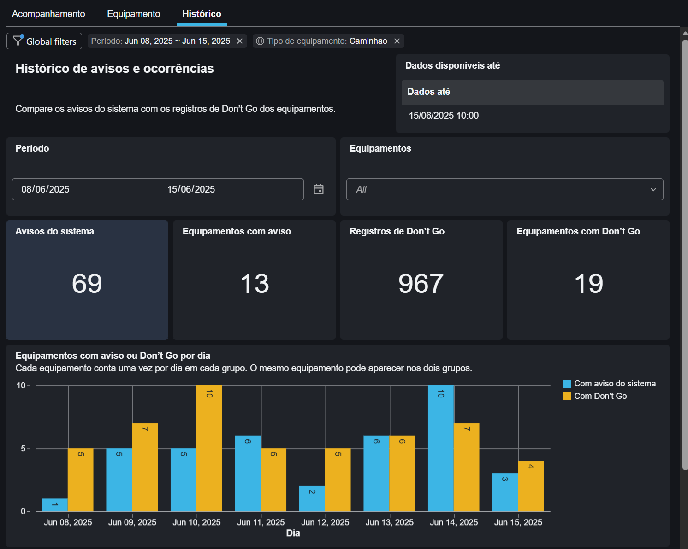
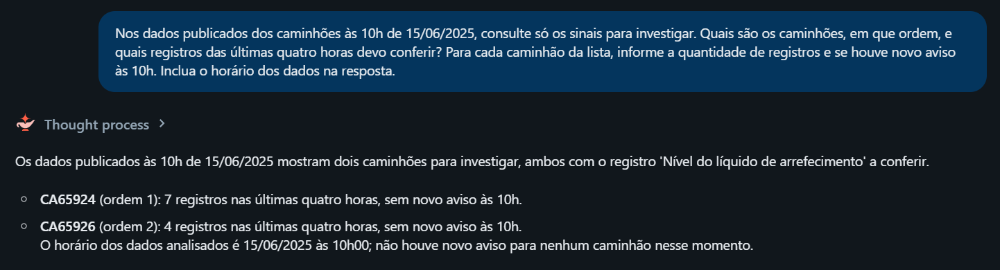

# Demonstração de uma investigação

As capturas mostram o dashboard publicado e a resposta do Genie para Caminhões,
com os dados disponíveis em **15/06/2025 às 10h**. Esse é o horário do recorte
histórico mostrado na interface.

## Conferir um equipamento

Ao abrir o caminhão CA65926, a aba **Equipamento** mostra que o sinal continuava
entre os prioritários às 10h. O aviso das 09h ainda estava dentro do intervalo
mínimo de quatro horas. A janela de registros vai das 06h até antes das 10h.

## Consultar avisos e registros anteriores

A aba **Histórico** mostra os avisos do sistema e os registros de Don’t Go
para o período filtrado. As barras contam equipamentos distintos por dia em
cada grupo. Um mesmo caminhão pode aparecer nos dois grupos.

## Consultar a fila no Genie

A pergunta restringe a consulta aos caminhões da fila. O Genie trouxe a mesma
ordem do painel, os sete e quatro registros de nível do líquido de arrefecimento
e a ausência de novo aviso para os dois caminhões às 10h. Esses registros servem
de ponto de partida para conferir a telemetria.

[Voltar ao projeto](../README.md)
